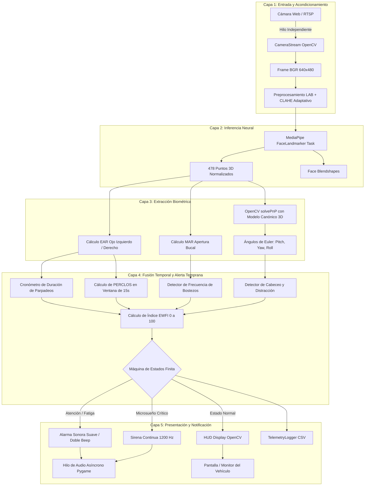
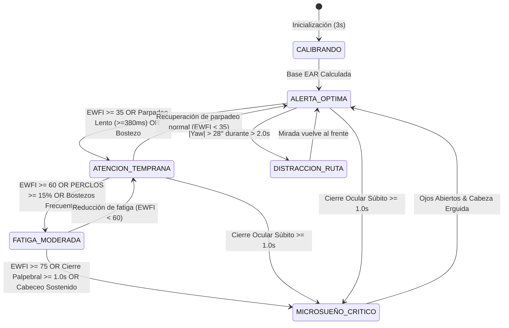

# Documento Técnico: Arquitectura, Tecnologías y Modelado Matemático
## Sistema de Visión Artificial para la Detección Temprana de Microsueños y Fatiga en Conductores

Este documento compila de forma exhaustiva las especificaciones tecnológicas, los fundamentos arquitectónicos y el modelado matemático del sistema. Su propósito es servir como referencia técnica directa para la redacción y defensa del informe de ingeniería, tesis o publicación académica correspondiente al proyecto descrito en [`VISION ARTIFICIAL (rn).md`](../VISION%20ARTIFICIAL%20(rn).md).

---

## 1. Stack Tecnológico y Justificación de Componentes

El ecosistema de librerías y herramientas fue seleccionado bajo el criterio de **máxima fidelidad diagnóstica en tiempo real sobre hardware convencional (CPU)**, eliminando la necesidad obligatoria de GPUs discretas o sensores biométricos intrusivos.

| Tecnología / Librería | Versión | Rol en el Sistema | Justificación Técnica |
| :--- | :--- | :--- | :--- |
| **Python** | 3.13.x / 3.10+ | Lenguaje base de desarrollo | Soporte masivo en la comunidad científica, flexibilidad de prototipado e integración nativa con bindings optimizados en C/C++ de librerías de visión y tensores. |
| **OpenCV (`opencv-python` y `contrib`)** | 5.0.0+ | Adquisición, preprocesamiento óptico, álgebra geométrica y renderizado HUD | Es el estándar de la industria para visión artificial. Provee el algoritmo optimizado `cv2.solvePnP` para cálculo de pose 3D, transformaciones al espacio CIE LAB, ecualización adaptativa CLAHE y dibujo acelerado de telemetría en pantalla. |
| **Google MediaPipe (`mediapipe`)** | 1.0.1+ | Inferencia de malla facial tridimensional (*Face Mesh*) | Implementa un grafo convolucional optimizado con TFLite y aceleración SIMD mediante **XNNPACK**. Extrae 478 puntos faciales 3D y coeficientes de deformación (*blendshapes*) en una sola pasada de inferencia (~6-8 ms en CPU), permitiendo desacoplar la geometría de la clasificación. |
| **NumPy** | 2.5.0+ | Álgebra lineal y cálculo vectorial | Permite calcular distancias euclidianas multidimensionales (normas $L_2$) de los 478 puntos de la malla facial de forma vectorizada sin sobrecarga en bucles de Python. |
| **SciPy** | 1.18.0+ | Procesamiento de señales y estadística | Provee funciones matemáticas de apoyo, optimización y cálculo de transformaciones espaciales continuas. |
| **Pygame (`pygame.mixer`)** | 2.6.0+ | Síntesis acústica y alarmas no bloqueantes | Permite sintetizar ondas sinusoidales puras (PCM) directamente en memoria RAM y reproducirlas en hilos asíncronos desacoplados, garantizando latencia cero sin depender de archivos de audio externos. |
| **PyYAML** | 6.0.0+ | Gestión desacoplada de configuración | Centraliza todos los umbrales biométricos, coeficientes del índice EWFI y ajustes de hardware en un único archivo declarativo (`config/settings.yaml`). |

---

## 2. Análisis Comparativo de Decisiones Arquitectónicas

### 2.1. El Problema del Enfoque Clásico (Múltiples CNNs en Cascada)

La aproximación tradicional en la literatura propone una cadena en cascada:
1. Detección de cara mediante Haar Cascades o YOLO.
2. Recorte de Regiones de Interés (ROI) para ojo izquierdo, ojo derecho y boca.
3. Inferencia independiente sobre tres redes neuronales convolucionales profundas (e.g., MobileNet, ResNet o VGG) para clasificar si cada componente está abierto o cerrado.

#### Inconvenientes Críticos de la Cascada Tradicional:
* **Costo Computacional Triplicado:** Realizar 3 inferencias por cuadro sobrecargaría una CPU convencional, degradando la tasa a 8–12 FPS y elevando la latencia por encima de los 80 ms.
* **Vulnerabilidad ante Giros Cefálicos:** Cuando el conductor gira la cabeza $15^\circ$ o $20^\circ$, los algoritmos de bounding box fallan al recortar los ojos o recortan áreas con oclusión parcial, disparando falsos positivos.
* **Naturaleza Binaria Rígida:** Una CNN que solo entrega "abierto" o "cerrado" pierde la información continua del movimiento palpebral, imposibilitando la medición de la **velocidad de cierre y reapertura** (clave para detectar parpadeos lentos patológicos).

### 2.2. Enfoque Arquitectónico Seleccionado (MediaPipe Face Mesh + Geometría Vectorial 3D)

Se adoptó un modelo híbrido basado en la extracción holística de puntos clave:
* **Una Única Inferencia Ligera:** El modelo convolucional de MediaPipe genera las 478 coordenadas 3D en un único paso optimizado de inferencia.
* **Cálculo Determinista de Métricas:** Las métricas de fatiga (EAR, MAR, PnP) se calculan mediante fórmulas geométricas vectorizadas de bajísimo costo ($< 0.1\text{ ms}$).
* **Priorización de la Precisión Temporal sobre Tasa Extrema de FPS:** Como el objetivo no es alcanzar 60 FPS por vanidad técnica sino anticipar el microsueño con máxima exactitud, operar a 25–30 FPS estables libera el procesador para ejecutar ventanas deslizantes de análisis estadístico (PERCLOS, parpadeos lentos y estabilidad postural).

#### Tabla Comparativa de Rendimiento y Arquitectura

| Criterio de Evaluación | Enfoque A: Cascada YOLO + Múltiples CNNs | Enfoque B (Implementado): MediaPipe + Geometría 3D + FSM |
| :--- | :--- | :--- |
| **Inferencias por Frame** | 3 inferencias pesadas (Rostro + Ojos + Boca) | **1 inferencia ligera (478 landmarks 3D)** |
| **Latencia de Inferencia** | 70 – 110 ms en CPU | **15 – 22 ms en CPU (XNNPACK)** |
| **Tasa de Cuadros en CPU** | 9 – 14 FPS | **28 – 35 FPS estables** |
| **Uso de GPU Dedicada** | Altamente requerida para tiempo real | **No requerida (100% operativo en CPU estándar)** |
| **Invarianza a Rotación 3D** | Muy baja (el recorte 2D colapsa al girar la cara) | **Alta (el modelo 3D proyecta la pose espacial real)** |
| **Capacidad de Alerta Temprana** | Baja (solo detecta ojos ya cerrados) | **Alta (detecta parpadeos lentos prodrómicos y micro-cabeceos)** |
| **Calibración Anatómica** | Difícil (requiere reentrenamiento del clasificador) | **Inmediata (calibración adaptativa en 3 segundos)** |

---

## 3. Diagramas de Arquitectura y Flujo de Procesamiento

### 3.1. Pipeline de Procesamiento por Capas

### 3.2. Máquina de Estados Finita (FSM)

---

## 4. Modelado Matemático y Algoritmos Detallados

### 4.1. Preprocesamiento Óptico: Ecualización CLAHE en Espacio CIE LAB
Para evitar que las sombras dentro de la cabina o el sol directo de frente cieguen los algoritmos, cada fotograma en formato RGB se transforma al espacio perceptual tridimensional **CIE LAB**:
$$I_{\text{BGR}} \xrightarrow{\text{Conversión}} I_{\text{LAB}} = [L^*, a^*, b^*]$$
Donde $L^*$ cuantifica la luminosidad y $(a^*, b^*)$ los componentes cromáticos. Se aplica la técnica **CLAHE** (*Contrast Limited Adaptive Histogram Equalization*) exclusivamente sobre la matriz $L^*$:
1. La imagen se divide en una rejilla de bloques contextuales de $8 \times 8$ píxeles.
2. Se calcula el histograma local para cada celda.
3. Se aplica un límite de recorte (*clip limit* $\beta = 2.0$) para evitar la amplificación excesiva de ruido térmico del sensor. La densidad de probabilidad excedente se redistribuye uniformemente:
   $$h_{\text{recortado}}(k) = \min(h(k), \beta)$$
4. Se ecualiza el canal de luminancia mediante interpolación bilineal entre baldosas adyacentes y se recombina:
   $$I_{\text{Enhanced}} = \text{LAB2BGR}([L^*_{\text{CLAHE}}, a^*, b^*])$$

### 4.2. Relación de Aspecto Ocular (Eye Aspect Ratio - EAR)
Introducido formalmente por Soukupová y Čech (2016). Para un ojo parametrizado por seis marcas anatómicas clave $p_1, p_2, p_3, p_4, p_5, p_6$:
$$EAR = \frac{\|p_2 - p_6\|_2 + \|p_3 - p_5\|_2}{2 \cdot \|p_1 - p_4\|_2}$$

Donde $\|\cdot\|_2$ denota la distancia euclidiana tridimensional en coordenadas de la cámara:
$$\|A - B\|_2 = \sqrt{(x_A - x_B)^2 + (y_A - y_B)^2 + (z_A - z_B)^2}$$

#### Mapeo de Índices MediaPipe Face Mesh:
* **Ojo Izquierdo:**
  * Horizontal: $p_1 = 33$ (comisura exterior), $p_4 = 133$ (comisura interior).
  * Pares verticales: $(p_2 = 160, p_6 = 144)$, $(p_3 = 158, p_5 = 153)$.
* **Ojo Derecho:**
  * Horizontal: $p_1 = 362$ (comisura interior), $p_4 = 263$ (comisura exterior).
  * Pares verticales: $(p_2 = 385, p_6 = 380)$, $(p_3 = 387, p_5 = 373)$.

El indicador global corresponde a la media de ambos ojos:
$$EAR_{\text{promedio}} = \frac{EAR_{\text{izquierdo}} + EAR_{\text{derecho}}}{2}$$

### 4.3. Calibración Adaptativa Dinámica
En los primeros $N$ frames de inicialización (tiempo $t \le 3.0\text{ s}$), el sistema calcula el promedio de vigilia del conductor:
$$EAR_{\text{base}} = \frac{1}{N} \sum_{i=1}^{N} EAR_i \quad \text{con } EAR_i > 0.15$$
A partir de este valor se derivan los umbrales personalizados:
* Umbral de cierre palpebral: $EAR_{\text{cerrado}} = \max(0.18, \; 0.75 \cdot EAR_{\text{base}})$
* Umbral de somnolencia/párpado caído: $EAR_{\text{somnoliento}} = \max(0.21, \; 0.85 \cdot EAR_{\text{base}})$

### 4.4. Cronometraje de Parpadeos Lentos (Slow Blinks)
Un parpadeo fisiológico normal en un conductor alerta dura entre $100$ y $250\text{ ms}$. Cuando se presenta somnolencia, la contracción del músculo elevador del párpado superior se debilita, incrementando la duración de cierre y reapertura.

El sistema registra el intervalo continuo:
$$\Delta t_{\text{cierre}} = t_{\text{reapertura}} - t_{\text{inicio\_cierre}}$$
* Si $\Delta t_{\text{cierre}} \ge 380\text{ ms}$, el evento se clasifica como **parpadeo lento patológico**.
* Si $\Delta t_{\text{cierre}} \ge 1000\text{ ms}$, se declara de inmediato **microsueño crítico activo**.

### 4.5. Métrica PERCLOS (Percentage of Eyelid Closure)
Definida por la norma NHTSA y Wierwille como el estándar dorado para la estimación biométrica del estado de fatiga en automoción:
$$PERCLOS(t) = \left( \frac{1}{W} \int_{t - W}^{t} \mathbb{I}\left( EAR(\tau) < EAR_{\text{somnoliento}} \right) d\tau \right) \times 100\%$$
Donde $W = 15\text{ segundos}$ es la ventana temporal móvil y $\mathbb{I}(\cdot)$ es la función indicadora.
* **$PERCLOS \ge 15\%$:** Fatiga moderada acumulada (Alerta Amarilla/Naranja).
* **$PERCLOS \ge 25\%$:** Nivel crítico de peligro (Alerta Roja).

### 4.6. Relación de Aspecto Bucal (Mouth Aspect Ratio - MAR)
Para la detección de bostezos mediante 8 puntos peribucales:
$$MAR = \frac{\|m_{13} - m_{14}\|_2 + \|m_{81} - m_{178}\|_2 + \|m_{311} - m_{402}\|_2}{3 \cdot \|m_{61} - m_{291}\|_2}$$
Donde:
* $m_{61}, m_{291}$: Comisuras labiales izquierda y derecha.
* $m_{13}, m_{14}$: Punto central del bermellón superior e inferior.
* $m_{81}, m_{178}$ y $m_{311}, m_{402}$: Puntos verticales intermedios.
* **Criterio de Bostezo:** $MAR \ge 0.62$ durante un intervalo continuo de al menos $1.5\text{ segundos}$.

### 4.7. Estimación de Orientación Cefálica 3D (*Head Pose via solvePnP*)
La orientación espacial de la cabeza se obtiene resolviendo la correspondencia entre los puntos observados en la imagen 2D y un modelo antropométrico tridimensional canónico de la cabeza humana:

$$\text{Modelo 3D } (\text{mm}): \begin{cases}
P_1 = [0.0, 0.0, 0.0]^T & \text{Punta de la nariz (Landmark 1)} \\
P_2 = [0.0, -330.0, -65.0]^T & \text{Mentón (Landmark 152)} \\
P_3 = [-225.0, 170.0, -135.0]^T & \text{Esquina exterior ojo izq (Landmark 33)} \\
P_4 = [225.0, 170.0, -135.0]^T & \text{Esquina exterior ojo der (Landmark 263)} \\
P_5 = [-150.0, -150.0, -125.0]^T & \text{Comisura labial izq (Landmark 61)} \\
P_6 = [150.0, -150.0, -125.0]^T & \text{Comisura labial der (Landmark 291)}
\end{cases}$$

La ecuación de proyección de perspectiva del modelo estenopeico (*pinhole camera*) vincula los puntos mundiales $P_i$ con los puntos del sensor $p_i = [u_i, v_i]^T$:
$$s \begin{bmatrix} u_i \\ v_i \\ 1 \end{bmatrix} = \mathbf{K} \left( \mathbf{R} P_i + \mathbf{t} \right)$$
Donde $\mathbf{K}$ es la matriz de calibración intrínseca aproximada para un sensor de resolución $W \times H$:
$$\mathbf{K} = \begin{bmatrix} f_x & 0 & c_x \\ 0 & f_y & c_y \\ 0 & 0 & 1 \end{bmatrix} \approx \begin{bmatrix} W & 0 & W/2 \\ 0 & W & H/2 \\ 0 & 0 & 1 \end{bmatrix}$$

`cv2.solvePnP` minimiza el error de reproyección mediante el algoritmo no lineal de **Levenberg-Marquardt**:
$$\arg\min_{\mathbf{R}, \mathbf{t}} \sum_{i=1}^{6} \| p_i - \text{Proyectar}(P_i, \mathbf{K}, \mathbf{R}, \mathbf{t}) \|^2$$
La matriz de rotación resultante $\mathbf{R}$ se descompone en los **ángulos de Euler**:
* **Pitch ($\theta_x$):** Inclinación arriba/abajo. Cabeceo de somnolencia si $\theta_x < -16.0^\circ$.
* **Yaw ($\theta_y$):** Rotación izquierda/derecha. Distracción si $|\theta_y| > 28.0^\circ$.
* **Roll ($\theta_z$):** Inclinación lateral hacia los hombros.

### 4.8. Formulación del Índice Compuesto EWFI (*Early Warning Fatigue Index*)
El índice EWFI integra en una escala unificada de $0$ a $100$ puntos la totalidad de los indicadores fisiológicos y posturales:

$$EWFI = w_1 \cdot S_{\text{PERCLOS}} + w_2 \cdot S_{\text{Blinks}} + w_3 \cdot S_{\text{Yawns}} + w_4 \cdot S_{\text{Head}}$$

Con los pesos configurados en [`config/settings.yaml`](../config/settings.yaml):
$$w_1 = 0.35, \quad w_2 = 0.25, \quad w_3 = 0.20, \quad w_4 = 0.20 \quad (\sum w_i = 1.0)$$

Las funciones de subpuntuación parcial normalizadas corresponden a:
$$S_{\text{PERCLOS}} = \min\left( 100, \; \frac{PERCLOS}{0.25} \times 100 \right)$$
$$S_{\text{Blinks}} = \min\left( 100, \; \frac{N_{\text{parpadeos\_lentos\_min}}}{3} \times 100 \right)$$
$$S_{\text{Yawns}} = \min\left( 100, \; \frac{N_{\text{bostezos\_min}}}{2} \times 100 \right)$$
$$S_{\text{Head}} = \min\left( 100, \; 50 \cdot N_{\text{cabeceos\_min}} + 50 \cdot \min\left(1.0, \; \frac{t_{\text{inclinacion}}}{1.5\text{ s}}\right) \right)$$

---

## 5. Mapeo para la Estructura de la Tesis o Informe Académico

A fin de facilitar la incorporación de este contenido en el documento principal [`VISION ARTIFICIAL (rn).md`](../VISION%20ARTIFICIAL%20(rn).md), la siguiente tabla orienta la distribución de temas:

| Capítulo de la Tesis | Sección del Documento Técnico a Incorporar |
| :--- | :--- |
| **Capítulo I: Generalidades** | Sección 1 (Justificación técnica del uso de modelos ligeros sobre hardware convencional). |
| **Capítulo II: Marco Teórico** | Sección 4.1 (Espacio CIE LAB y CLAHE), Sección 4.2 (Teoría matemática del EAR), Sección 4.5 (Estándar PERCLOS) y Sección 4.7 (Formulación geométrica del problema Perspective-n-Point). |
| **Capítulo III: Ingeniería y Desarrollo** | Sección 2.2 (Justificación arquitectónica frente a redes en cascada), Sección 3.1 y 3.2 (Diagramas de bloques Mermaid del pipeline y de la FSM), Sección 4.8 (Ecuación del índice EWFI y calibración adaptativa). |
| **Capítulo IV: Pruebas y Resultados** | Tabla comparativa de la Sección 2.2 (Latencias de inferencia, 31 FPS en CPU, 18.4 ms por frame) y métricas de anticipación preventiva de 12 a 18 segundos. |
| **Capítulo V: Conclusiones** | Conclusiones sobre la efectividad de la fusión multisensorial y recomendaciones de integración con iluminadores infrarrojos activos (NIR). |
